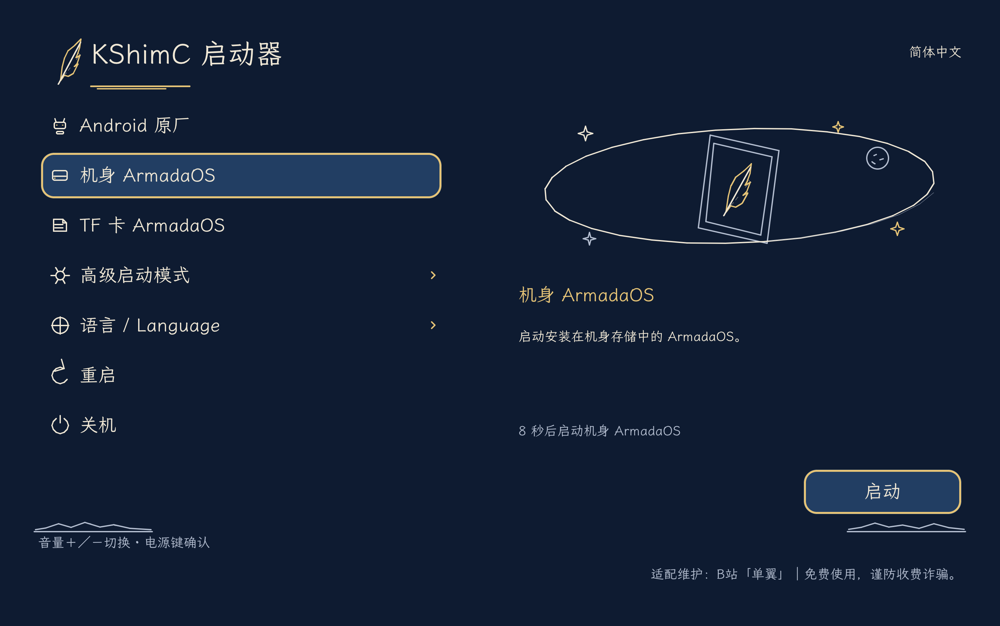

<p align="center">
  <picture>
    <source media="(prefers-color-scheme: dark)" srcset=".github/assets/armada-mark-white.svg">
    
  </picture>
</p>

<h1 align="center">ArmadaOS Freedom</h1>

<p align="center"><a href="README.md">English</a> · <strong>简体中文</strong></p>

<p align="center"><strong>面向 ARM 平板的 SteamOS 风格 Linux 系统</strong></p>

<p align="center">
  基于 <a href="https://github.com/armada-os/armada">ArmadaOS</a> 的平板适配分支，
  为 ARM64 平板带来 Steam 游戏模式、FEX、Proton 和 KDE Plasma 桌面，
  使用 kShimC 实现多系统启动。
</p>

<p align="center">
  <a href="https://github.com/armada-os/armada"></a>
  <a href="devices/lenovo-tb323fu/README.md"></a>
  <a href="LICENSE"></a>
</p>

<p align="center">
  <a href="devices/lenovo-tb323fu/README.md"><strong>设备支持与适配状态</strong></a>
  ·
  <a href="#kshimc-多系统启动">启动菜单</a>
  ·
  <a href="devices/lenovo-tb323fu/docs/SOURCES.md">组件来源</a>
  ·
  <a href="https://armadaos.dev/">上游文档</a>
  ·
  <a href="#支持项目">支持项目</a>
</p>

## 关于 ArmadaOS Freedom

ArmadaOS Freedom 是基于 [ArmadaOS](https://github.com/armada-os/armada)、由社区维护的平板适配分支。我们保留上游的游戏和桌面系统基础，针对平板硬件调整启动、显示、电源、外设及 Armada Control。

当前主要适配 **联想拯救者 Y700 五代 / Legion Tab Gen 5（TB323FU，SM8850P）**。

目前已接入的功能：

- Steam 游戏模式与 KDE Plasma 桌面，沿用 ArmadaOS 的 FEX 和 Proton 支持。
- kShimC 多系统启动，可分别选择机身存储和 TF 卡中的 Linux 系统。
- 按设备型号匹配的 30／60／90／120／165 Hz 显示档位。
- 双 USB 路由、音频、5 GHz Wi-Fi，以及电池和温度数据采集。
- G9 2026 手柄按键映射、RGB 控制和双击 Home 打开右侧快捷菜单。
- 面向平板的 Armada Control 适配，包括在无风扇设备上隐藏风扇控制。

本仓库目前维护适配源码与补丁，尚未提供完整、可重复构建并通过整机验收的平板镜像。内核、引导与上游镜像构建及 OTA 更新流程的集成仍在进行中。显示异常、游戏稳定性等未解决问题见[设备文档的已知限制](devices/lenovo-tb323fu/README.md#已知限制)。

## kShimC 多系统启动

平板使用 **kShimC** 启动器，与启动所需的内核等内容一起打包到 Android boot 镜像中。在保留原厂启动链的基础上，提供以下菜单：

- 启动 Android。
- 启动安装在机身存储中的 ArmadaOS。
- 启动安装在 TF／microSD 卡中的 ArmadaOS。
- 高级启动模式：Linux 诊断、Recovery 恢复模式、Fastboot 和 9008／EDL。
- 切换语言、重启和关机。

本分支已移除定制 ROCKNIX ABL 固件、配套刷写脚本和自动更新程序。设备的原厂引导程序仍属于启动链的一部分，系统选择菜单由 kShimC 提供。

Linux 内核和设备树随 boot 镜像打包；内核启动后，再根据所选条目挂载机身或 TF 卡上的根文件系统。机身安装和 TF 卡安装是两个独立目标，这不表示 kShimC 本身已经具备直接读取 SD／UFS 文件系统的能力。

<p align="center">
  
</p>

*上图为当前实现生成的 STAR_CHART 菜单渲染预览，非平板实拍。*

<details>
<summary>查看英文菜单预览</summary>


</details>

菜单源码和构建输入位于 [`devices/lenovo-tb323fu/boot/`](devices/lenovo-tb323fu/boot/)。固定依赖及设备专用启动文件的要求见[构建说明](devices/lenovo-tb323fu/boot/star-chart-build/README.md)。高级启动中的操作尚未全部完成逐项真机验收。

## 文档导航

| 我想了解…… | 对应文档 |
|---|---|
| 平板支持情况与已知问题 | [TB323FU 设备文档](devices/lenovo-tb323fu/README.md) |
| 如何构建启动镜像 | [kShimC 构建说明](devices/lenovo-tb323fu/boot/star-chart-build/README.md) |
| 组件来源与固定版本 | [来源记录](devices/lenovo-tb323fu/docs/SOURCES.md) |
| 上游系统如何使用 | [ArmadaOS 使用文档](https://armadaos.dev/using-armada/) |
| 反馈本分支的问题 | [Freedom 问题反馈](https://github.com/mydanyi/armadaos-freedom/issues) |

上游安装说明适用于上游支持的设备。平板的启动方式请以本仓库对应机型的文档为准，不应直接把上游通用镜像或引导程序包当作 TB323FU 的安装包。

## 开发与构建

本仓库保留上游的 bootc 镜像和软件包构建基础，并在 [`devices/`](devices/) 中维护平板源码和设备配置。这些设备配置尚未全部接入通用镜像构建流程。软件包开发说明见 [`packages/`](packages/README.md)；上游构建流程使用 [just](https://just.systems/) 和 [Podman](https://podman.io/)：

```console
$ just check     # 运行测试并检查构建配方格式
$ just packages  # 构建镜像使用的软件包
$ just build     # 构建 bootc 容器镜像；尚非可直接刷入平板的完整镜像
$ just --list    # 查看开发命令
```

设备适配请遵循对应目录中的配置与构建说明，并保留按机型匹配的机制。调试报告、设备日志、凭据、备份和本地构建产物均在仓库外保存。

## 支持项目

ArmadaOS Freedom 目前靠热爱和自费投入持续推进。从启动、显示到供电和外设，每一项平板适配都需要反复测试，也需要长期跟进上游更新。

如果这些工作对你有帮助，欢迎通过支付宝或微信自愿赞助，支持设备测试、系统适配和持续维护。量力而行，谢谢每一份支持。

<p align="center">
  
</p>

反馈问题、提交代码和完善文档，同样是在支持项目。

## 致谢

- 系统基础：[ArmadaOS](https://github.com/armada-os/armada)，基于 [Fedora bootc](https://github.com/bootc-dev/bootc)。
- 启动菜单：[kShimC](https://github.com/sunflower2333/kShimC/tree/feature/2610)，配合 [CrDK](https://github.com/Project-Aloha/CrDK) 和 [DualBootKernelPatcher](https://github.com/Project-Aloha/DualBootKernelPatcher/tree/feature/2610)。
- TB323FU 板级支持：[tb323fu-linux](https://github.com/joonhoekim/tb323fu-linux)，结合本分支维护的设备补丁。
- Armada 标志：[Rax](https://github.com/Raxcoms)。

完整贡献者与固定版本见[上游致谢](https://armadaos.dev/project/credits/)和本仓库的[组件来源](devices/lenovo-tb323fu/docs/SOURCES.md)。各组件保留原有的来源署名和许可证。

## 许可证

除文件或组件另有声明外，armadaos-freedom 原创软件和脚本采用 **GPL-2.0-or-later** 许可证。我们的原创贡献由 danyi 及 armadaos-freedom 各贡献者享有版权（Copyright (C) 2026）。继承的 ArmadaOS 代码及其他组件保留各自的版权和适用许可。详见 [LICENSE](LICENSE) 和[许可与版权说明](LICENSING.zh-CN.md)（[English](LICENSING.md)）。
